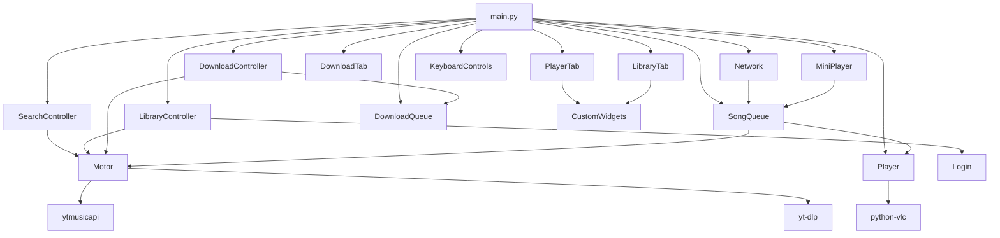

# ReproBabb - Complete Documentation & Project Guide

A minimalist **YouTube Music desktop player** built with Python and Qt6 (PySide6).
Audio plays through VLC via `python-vlc`, downloads go through `yt-dlp`, and YouTube Music data comes from `ytmusicapi`.

> **Unofficial client.** Not affiliated with YouTube or Google. For personal use only: downloading content may violate YouTube's Terms of Service and the rights of content owners, and you are responsible for how you use this software.

## Table of Contents

1. [Key Features](#key-features)
2. [Installation & Requirements](#installation--requirements)
3. [User Guide](#user-guide)
4. [System Architecture](#system-architecture)
5. [Project Structure](#project-structure)
6. [Performance Optimizations (Model/View)](#performance-optimizations-modelview)
7. [Data Flow & Concurrency](#data-flow--concurrency)
8. [Testing](#testing)
9. [Known Limitations](#known-limitations)
10. [Troubleshooting](#troubleshooting)
11. [Third-Party Software & Licenses](#third-party-software--licenses)

---

## Key Features

* **Audio Streaming**: Instant search and playback directly from YouTube Music. You can also paste a video or playlist link into the search bar to play it directly.
* **Library Management**: Browse your personal playlists (via browser session authentication with `browser.json`), search inside a playlist, play it shuffled, and add or remove songs.
* **Virtualized Playback Queue**:
  * Jump directly between songs by clicking.
  * Native reordering via **Drag & Drop**, including while shuffle is active.
  * Remove songs from the queue, including the one currently playing (playback continues with the next song, or stops if it was the last one).
  * **Shuffle** Mode: Randomizes playback order while keeping the currently playing song first when shuffle is toggled on.
  * **Play Next** from the context menu.
* **Similar Songs**: Selecting a single song starts a queue of similar tracks.
* **Download Manager**: Download individual tracks or entire playlists with progress indicators and cancellation support. The output format is selected by `yt-dlp`; this app does not configure MP3 conversion.
* **Download Location**: Choose or change the download folder from the Downloads tab.
* **Mini Player**: Open a compact, always-on-top player window while hiding the main window.
* **Always Visible**: Optional setting that keeps the main window on top of other windows.
* **Animated Visualizer**: A decorative bar animation (the bar heights are random, it does not analyze the audio) that also works as the seek bar. Its accent color is derived from the average color of the current album cover.
* **Keyboard Shortcuts**: Playback and volume controls, plus global media keys.

---

## Installation & Requirements

### Prerequisites

* **Python 3.10+**
* **VLC Media Player**: Required, and **not included** with ReproBabb. Install it from [videolan.org](https://www.videolan.org/vlc/). Its architecture (32-bit vs. 64-bit) must match ReproBabb's (e.g., 64-bit Python or the 64-bit executable requires 64-bit VLC). If VLC cannot be found at startup, ReproBabb shows a message explaining how to install it.
* **ffmpeg**: Optional. This application does not configure audio extraction or conversion to MP3.

> **Platform:** Windows is the primary target (VLC detection, `AppData` storage and the PyInstaller build are set up for it). Other platforms have not been tested.

### Installation Steps

```bash
# 1. Clone the repository
git clone https://github.com/Adambabb/ReproBabb.git
cd ReproBabb

# 2. Create and activate a virtual environment
python -m venv .venv
# On Linux/macOS:
source .venv/bin/activate
# On Windows:
.venv\Scripts\activate

# 3. Install dependencies
pip install -r requirements.txt

# 4. Launch the application
python main.py
```

---

## User Guide

1. **Search & Playback**: Enter a song or artist name in the search bar above the queue. Click a result to begin playback; selecting one result also fetches similar tracks for the queue. You can also paste a YouTube / YouTube Music video or playlist link to play it directly.
2. **Playlist Search & Shuffle**: In **Library**, select a playlist to search its tracks or choose **Play Shuffled**.
3. **Queue Actions**: Right-click a queue or search-result track for available actions such as **Play Next**, **Add to playlist**, **Download** and **Remove from Queue**. Queue tracks can be reordered with drag and drop. The **+** button next to the volume control adds the current song to one of your playlists.
4. **Mini Player**: Select **Mini Player** in the main player. The main window is hidden until you choose **Full** or close the mini-player.
5. **Downloads**: The first time you download something, you are asked for a destination folder. Use **Change Download Folder** in the Downloads tab to change it later. Monitor progress and cancel pending or active jobs with the **X** button.
6. **Always Visible**: Click the settings button in the player to toggle keeping the window on top.

### Authentication for Personal Library

1. Open the **Library** tab and click **Create Browser**.
2. In the web window that opens, sign in to your Google / YouTube Music account.
3. Once the browser completes navigation to `music.youtube.com`, the window closes automatically, and your user playlists will load.

The app remembers the session file and loads it automatically on the next launch. If you already have a valid `browser.json`, you can load it with **Browse_Account:...**.

> **Security Note:** Your session is stored locally as `browser.json` inside your system's user application data folder (`AppData`). It contains your Google session cookies, so treat it like a password: never share it or commit it to a public repository.

### Keyboard Shortcuts

| Key | Action | Scope |
| --- | --- | --- |
| `Space` | Play / Pause | Player tab |
| `←` / `→` | Previous track / Next track | Player tab |
| `↑` / `↓` | Volume Up / Volume Down | Player tab |
| `Media Play/Pause` key | Play / Pause | Global |
| `Media Next` key | Next track | Global |

> **Privacy note:** The media keys work even when the app is not focused. To achieve this, `KeyboardControls` (`keyboard_controls.py`) uses `pynput` to register a system-wide keyboard listener. The code only reacts to the two media keys above and does not store or transmit any other keystroke.

---

## System Architecture

The project follows a modular, decoupled pattern where **`main.py`** acts as the orchestrator. It delegates business logic to dedicated controllers and handles UI rendering using Qt's **Model/View** architecture.



### Module Breakdown

| Module | Responsibility |
| --- | --- |
| **`main.py`** | Application entry point. Instantiates the window, tabs, and controllers, and connects global signals/slots and timers. |
| **`controllers/search_controller.py`** | Handles background search threads, result version filtering, similar-track lookup, and thumbnail requests for the results. |
| **`controllers/library_controller.py`** | Manages user session loading, asynchronous playlist fetching, and playlist track modifications. |
| **`controllers/download_controller.py`** | Coordinates background single-track and playlist download threads, cancellation, and the configured download folder. |
| **`motor.py`** | Data layer with no Qt dependencies. Direct wrapper for `ytmusicapi` and `yt_dlp`. |
| **`player.py`** | Wrapper around `python-vlc`. Manages playback states, track length, and playback position. Raises `VlcNotAvailableError` when VLC cannot be loaded. |
| **`song_queue.py`** | Queue business logic (`SongQueue`) and the list data model (`QueueModel` inheriting from `QAbstractListModel`). |
| **`download_queue.py`** | Thread-safe state holder (`threading.Lock`) for active downloads, progress percentages, and cancellation flags. |
| **`player_tab.py` / `library_tab.py` / `download_tab.py`** | Views and UI components for the three main tabs. |
| **`mini_player.py`** | Compact always-on-top player window sharing the playback queue and controls. |
| **`keyboard_controls.py`** | Global listener (`pynput`) for the media play/pause and media next keys. |
| **`network.py`** | Asynchronous thumbnail downloader: a `ThreadPoolExecutor` for list thumbnails (with loaded/pending tracking to avoid duplicate requests) and plain threads for cover art. |
| **`custom_widgets.py`** | Lightweight pixel-level delegate (`SongItemDelegate`) and custom widgets (`TimeDesign`, `VolumeDesign`). |
| **`login.py`** | Web engine dialog (`QWebEngineView`) used to capture the Google session cookie. |
| **`utils.py`** | Utility function `resource_path()` for resolving resource paths in both source code and PyInstaller executable builds. |
| **`styles/styles.qss`** | Global QSS stylesheet for application styling. |

---

## Project Structure

```
ReproBabb/
├── main.py
├── controllers/
│   ├── download_controller.py
│   ├── library_controller.py
│   └── search_controller.py
├── mini_player.py
├── keyboard_controls.py
├── player_tab.py
├── library_tab.py
├── download_tab.py
├── player.py
├── song_queue.py
├── download_queue.py
├── motor.py
├── network.py
├── custom_widgets.py
├── login.py
├── utils.py
├── styles/
│   └── styles.qss
├── assets/               # Icons and default album cover image
├── tests/
│   ├── test_download_queue.py
│   ├── test_motor.py
│   ├── test_player.py
│   └── test_queue.py
├── ReproBabb.spec        # PyInstaller build configuration
├── pytest.ini
├── requirements.txt
├── requirements-dev.txt
└── LICENSE
```

---

## Performance Optimizations (Model/View)

To reduce UI freezes and CPU/memory overhead when loading large song collections (such as playlists with hundreds of tracks), the application uses a virtualized architecture:

1. **`QListView` + `QAbstractListModel`**:
   * `QueueModel` (`song_queue.py`), `PlaylistSongsModel` (`library_tab.py`) and `DownloadModel` (`download_tab.py`) manage internal data structures.
   * Row insertion, removal, and reordering use granular Qt methods (`beginInsertRows`, `beginRemoveRows`, `beginMoveRows`) to update views without rebuilding the entire list. Loading a whole new playlist resets the model.

2. **Pixel-Level Render Delegates (`SongItemDelegate` in `custom_widgets.py`, `DownloadItemDelegate` in `download_tab.py`)**:
   * Instead of instantiating hundreds of heavy `QWidget` rows (`QFrame`, `QLabel`, etc.), the delegates render only visible rows directly on screen using `QPainter`.
   * Uses `QFontMetrics.elidedText` to dynamically truncate long titles or artist names with `"..."` when exceeding visible bounds.

3. **Native Drag & Drop**:
   * `QueueModel` implements native drag & drop reordering using a custom MIME type (`application/x-reprobabb-song-row`). Dragging rows alters the internal memory list without reconstructing UI widgets.

4. **Thumbnail Caching**:
   * `network.py` tracks which list thumbnails are already loaded or pending, so the same cover is not requested twice.
   * The models keep a `_thumbnail_cache` mapping icons to track IDs, so cover art stays visible when reordering or moving items.

---

## Data Flow & Concurrency

* **Background Threads (`threading.Thread` & `ThreadPoolExecutor`)**: Search, playback URL resolution, playlist-content fetching, thumbnail downloads, and media downloads run outside the main GUI thread. Account/session loading also makes synchronous API calls. Background results that update Qt views are passed through Qt signals (`PySide6.QtCore.Signal`).
* **Timer Polling**: Rapidly changing UI elements (such as the playback timeline or download progress bars) poll state data via `QTimer` instances rather than emitting hundreds of signals per second, keeping event queues responsive.
* **Download Progress & Cancellation**: `yt-dlp` jobs report progress through a hook that uses the exact total size when available and falls back to `yt-dlp`'s estimate. The same hook checks `is_cancelled_fn` and raises `DownloadCancelled` at the next callback. Jobs cancelled while pending do not start.
* **Queue State**: `SongQueue` protects its indices with a lock. When the currently playing song is removed, the next one starts immediately and the index stays consistent in both normal and shuffle modes.

---

## Testing

The core logic is covered by unit tests written with [pytest](https://docs.pytest.org/). None of them needs VLC, a network connection or a running Qt application window:

| Test file | What it covers |
| --- | --- |
| `tests/test_download_queue.py` | Download registration, progress/status updates, cancellation and the pending-cancelled rule. |
| `tests/test_motor.py` | `ytmusicapi` and `yt-dlp` wrappers with mocks, URL handling and the download progress hook. |
| `tests/test_player.py` | Playback state handling with a mocked `vlc`, including the "VLC not available" errors. |
| `tests/test_queue.py` | `SongQueue`: indices, shuffle, adding, reordering and removing songs (using a fake player). |

To run them:

```bash
pip install -r requirements-dev.txt
pytest
```

The user interface (tabs, mini player, delegates) is not covered by automated tests.

---

## Known Limitations

* **Visualizer**: Decorative only. It does not analyze the audio being played.
* **Fragile streaming**: Playback and downloads rely on `yt-dlp` and on YouTube's internal clients (`android` / `ios`), which can stop working when YouTube changes its APIs. Updating `yt-dlp` and `ytmusicapi` usually fixes it.
* **Download format**: The format is chosen by `yt-dlp`; MP3 conversion is not configured.
* **Session storage**: The library session is based on browser cookies stored in `browser.json` and may expire.
* **No repeat mode**: Playback stops after the last song of the queue.
* **Shuffle order**: After dragging songs while shuffle is active, the queue keeps the order you left it in. Turning shuffle off does not restore the original playlist order.
* **Repeated songs**: If the same song appears more than once in the queue, it is identified by its ID when reordering, so the wrong copy may be treated as the current one.
* **Platform**: Developed for Windows. Other platforms are untested.

---

## Troubleshooting

* **VLC not found / playback fails to start (`python-vlc` cannot find VLC)**:
  ReproBabb does not bundle VLC, so it must be installed separately. Make sure its architecture matches ReproBabb's (e.g., both 64-bit). A portable VLC without registry entries may not be detected.

* **Downloads fail**:
  Check your network connection and the error shown in the Downloads tab. `yt-dlp` selects the available output format; this application does not configure MP3 conversion.

* **Search or Library requests fail unexpectedly**:
  YouTube frequently updates its internal APIs. Update the core dependencies by running:
  ```bash
  pip install -U yt-dlp ytmusicapi
  ```

* **Expired library session error**:
  Open the **Library** tab, click **Create Browser**, and sign in again to regenerate your local `browser.json` credentials.

---

## Third-Party Software & Licenses

### VLC media player

ReproBabb plays audio through [VLC](https://www.videolan.org/vlc/) using the `python-vlc` bindings.

* **VLC media player** is released under the **GNU GPL v2 (or later)**.
* **libVLC**, the engine that `python-vlc` loads, is released under the **GNU LGPL v2.1 (or later)**.
* VLC is a separate program developed by the VideoLAN project. **ReproBabb does not include or redistribute VLC**: you install it yourself, and ReproBabb only loads it at runtime through `python-vlc`. ReproBabb's own code remains under the MIT License.

VLC is a trademark of the VideoLAN project. ReproBabb is not affiliated with or endorsed by VideoLAN.

### Other dependencies

| Package | Purpose | License |
| --- | --- | --- |
| **PySide6** (Qt for Python) | User interface | LGPL v3 / GPL v3 / commercial |
| **python-vlc** | VLC bindings | LGPL v2.1 (or later) |
| **yt-dlp** | Audio extraction and downloads | Unlicense |
| **ytmusicapi** | YouTube Music data | MIT |
| **pynput** | Global media-key listener | LGPL v3 |
| **pytest** (development only) | Unit tests | MIT |

Each package is distributed under its own license; check the respective project for the exact terms of the version you use.

---

## License

This project is licensed under the **MIT License**. See the `LICENSE` file for details. The third-party software listed above is covered by its own licenses.