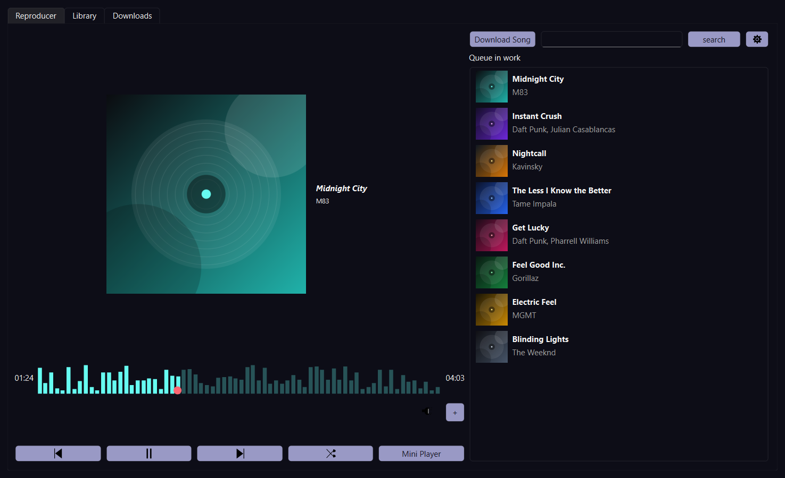
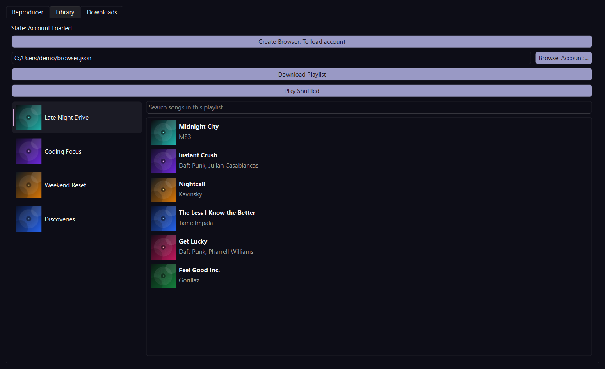
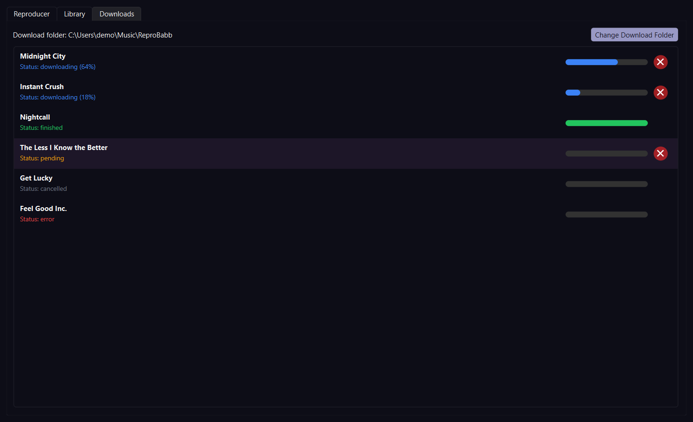
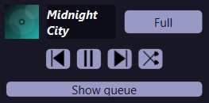
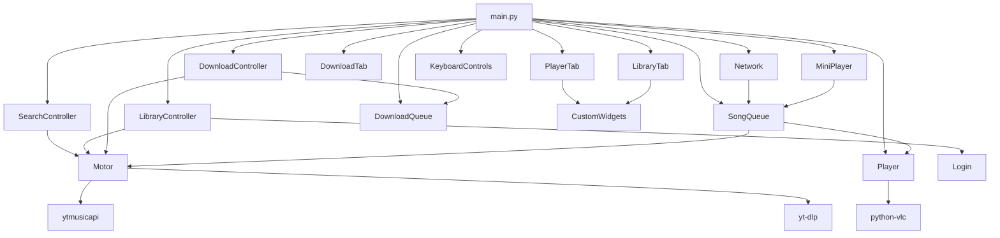

<div align="center">

# ReproBabb

**A minimalist YouTube Music desktop player for Windows.**

Search, stream, queue, organize and download music from YouTube Music in a compact Qt 6 interface.

[](https://github.com/Adambabb/ReproBabb/actions/workflows/tests.yml)
[](https://github.com/Adambabb/ReproBabb/releases)
[](https://www.python.org/)
[](LICENSE)

[Features](#features) | [Screenshots](#screenshots) | [Quick start](#quick-start) | [Architecture](#architecture) | [Testing](#testing) | [Limitations](#known-limitations)

</div>

---

ReproBabb is an unofficial desktop client for YouTube Music built with **Python**, **PySide6 (Qt 6)**, **VLC**, **yt-dlp** and **ytmusicapi**. It focuses on a fast queue, a clean dark interface and a small set of features that work well together: search, playback, personal playlists, downloads and a miniature always-on-top player.

> **Unofficial client.** ReproBabb is not affiliated with YouTube or Google. Downloading content may violate YouTube's Terms of Service and the rights of content owners. Use it for personal use only and respect copyright.

## Project status

The last tagged release is **v1.0.0**. The `main` branch is ahead of that tag and includes the work listed below. The v1.0.0 ZIP is useful if you want the original tagged build, but it predates these fixes; run from source or wait for the next release if you want the latest code.

| Area | v1.0.0 | Current main |
| --- | --- | --- |
| Tests | 82 | **83** |
| CI | Not configured | **GitHub Actions on Windows** |
| Account loading | Could block the UI | **Runs in a background thread** |
| Download controller | Working | **Working; regression from PR #10 fixed** |
| Error handling | Partial | **Search, library and controller errors are surfaced** |
| Documentation | Text only | **Screenshots and expanded guide** |

The download-controller regression was introduced when `_run_download` was removed from the controller and was restored in commit `a6c3ad4`. CI now runs the full pytest suite on every push and pull request.

## Screenshots

The screenshots use a local demo queue and synthetic cover art. They do not require a YouTube account, a network connection or a real listening session.

### Player and queue



The player combines the current cover and track information with a virtualized queue. Search results can be played directly, similar songs extend the queue, and queue rows support drag-and-drop reordering.

### Library



The Library tab loads the playlists associated with a browser session. Once a playlist is selected, its songs can be searched, played, shuffled, removed or downloaded as a playlist.

### Downloads



Downloads can be started for a single track or a whole playlist. Progress is updated from `yt-dlp` hooks, pending or active jobs can be cancelled, and the destination folder can be changed at any time.

### Mini player

<p align="center">
  
</p>

The mini player keeps the current track, playback controls and queue access available while the main window is hidden.

## Features

### Search and playback

- Search YouTube Music and start playback directly from the results.
- Paste a YouTube or YouTube Music video or playlist URL into the search bar to play it directly.
- Start a queue of similar tracks from a selected song.
- Use **Play Next** from a context menu to insert a track after the current one.
- Global media Play/Pause and Next keys, plus in-window shortcuts.

### Queue

- Virtualized `QListView` backed by a `QAbstractListModel`.
- Click any queue row to jump to it.
- Native drag-and-drop reordering, including while shuffle is active.
- Shuffle mode keeps the current song in place when enabled.
- Remove any queue row, including the currently playing track; playback advances to the next track or stops at the end of the queue.
- Thumbnail cache keeps cover art attached to rows while reordering.

### Library

- Load a personal YouTube Music library through a browser session (`browser.json`).
- Browse playlists and search inside the selected playlist.
- Play a playlist normally or shuffled.
- Add the current song to a playlist or remove a song from the current playlist with the context menu.

### Downloads

- Download individual tracks or complete playlists.
- Progress percentages, pending/downloading/finished/cancelled/error states and cancellation.
- Choose or change the download folder from the Downloads tab.
- Playlist folders are sanitized for Windows-invalid characters and reserved names.
- The output format is selected by `yt-dlp`; ReproBabb does not configure MP3 conversion.

### Desktop experience

- Compact, always-on-top mini player with an expandable queue.
- Optional always-on-top mode for the main window.
- Decorative bar visualizer that doubles as the seek bar.
- Accent color derived from the current cover art.
- Dark QSS theme with native Qt controls.

## Quick start

### Requirements

- **Windows 10 or Windows 11**. Other platforms are not officially tested.
- **Python 3.10+** for running from source. The CI workflow uses Python 3.14.
- **VLC Media Player**, installed separately. The architecture must match the Python/executable architecture: a 64-bit ReproBabb build needs 64-bit VLC.
- **ffmpeg** is optional. It is not needed to launch the app and ReproBabb does not configure MP3 conversion.

VLC is **not bundled** with ReproBabb. If VLC is missing, the app shows an error at startup.

### Run from source

```bash
git clone https://github.com/Adambabb/ReproBabb.git
cd ReproBabb

python -m venv .venv
.venv\Scripts\activate

python -m pip install -r requirements.txt
python main.py
```

On Linux or macOS the activation command is `source .venv/bin/activate`, but those platforms are not tested.

### Run the packaged release

Download the latest ZIP from the [Releases page](https://github.com/Adambabb/ReproBabb/releases), extract it and run `ReproBabb.exe`. The v1.0.0 release predates the fixes listed in [Project status](#project-status); build from `main` for the newest code.

## User guide

1. **Search and play:** type a song, artist or URL in the search box. Select a result to play it and populate the queue with similar tracks.
2. **Playlist search and shuffle:** open **Library**, select a playlist, then search inside it or choose **Play Shuffled**.
3. **Queue actions:** right-click a queue or search-result row for **Play Next**, **Add to playlist**, **Download** or **Remove from Queue**. Drag rows to reorder them. The **+** button next to the player adds the current song to a playlist.
4. **Mini player:** choose **Mini Player** in the player controls. The main window hides until you choose **Full** or close the mini player. Use **Show queue** to expand the mini queue.
5. **Downloads:** the first download asks for a destination folder. Change it later with **Change Download Folder** in the Downloads tab. A cancel button appears for pending or active jobs.
6. **Always visible:** use the settings button in the player to keep the main window above other windows.

### Library authentication

1. Open the **Library** tab and click **Create Browser**.
2. Sign in to your Google / YouTube Music account in the embedded browser window.
3. When navigation reaches `music.youtube.com`, the window closes and the playlists load.

The session is saved locally as `browser.json` inside the system's user application data folder (`AppData`). ReproBabb remembers the path and tries to load it automatically on the next launch. If the session expires, create a new browser session.

> **Security note:** `browser.json` contains Google session cookies. Treat it like a password. Never share it or commit it to a public repository. The project `.gitignore` excludes `browser.json`, `*browser*.json`, `oauth.json` and `headers_auth.json`.

### Keyboard shortcuts

| Key | Action | Scope |
| --- | --- | --- |
| `Space` | Play / Pause | Player tab |
| `Left` / `Right` | Previous track / Next track | Player tab |
| `Up` / `Down` | Volume up / Volume down | Player tab |
| Media Play/Pause | Play / Pause | Global |
| Media Next | Next track | Global |

The global media keys are handled by `pynput`. The listener only reacts to the two media keys above; it does not record or transmit other keystrokes.

## Architecture

ReproBabb follows a modular, decoupled pattern. `main.py` is the application orchestrator: it creates the window, tabs, controllers, models and signals. Business logic lives in controllers and data modules; the UI does not call `ytmusicapi` or `yt-dlp` directly.



### Module breakdown

| Module | Responsibility |
| --- | --- |
| `main.py` | Entry point and orchestrator. Creates tabs, controllers, queues and signal connections. |
| `controllers/search_controller.py` | Background searches, result version filtering, similar-track lookup and thumbnail requests. |
| `controllers/library_controller.py` | Background account/session loading, playlist fetching and playlist modifications. |
| `controllers/download_controller.py` | Single-track and playlist download threads, cancellation, folder selection and error reporting. |
| `motor.py` | Data layer with no Qt dependencies. Wrapper for `ytmusicapi` and `yt_dlp`. |
| `player.py` | VLC wrapper. Playback state, duration, seek position and `VlcNotAvailableError`. |
| `song_queue.py` | Queue business logic (`SongQueue`) and the `QueueModel` used by the player and mini player. |
| `download_queue.py` | Thread-safe download registry with progress, status and cancellation flags. |
| `player_tab.py` / `library_tab.py` / `download_tab.py` | Views and tab-specific widgets for the three main sections. |
| `mini_player.py` | Compact always-on-top player sharing the main queue. |
| `keyboard_controls.py` | Global listener for media Play/Pause and Next. |
| `network.py` | Asynchronous thumbnail loader with duplicate-request tracking. |
| `custom_widgets.py` | Pixel-level delegates and custom visualizer/volume widgets. |
| `login.py` | Embedded browser dialog used to capture the Google session. |
| `utils.py` | `resource_path()` for source and PyInstaller builds. |
| `styles/styles.qss` | Global dark theme and component styling. |

### Project structure

```text
ReproBabb/
|-- main.py
|-- controllers/
|   |-- download_controller.py
|   |-- library_controller.py
|   `-- search_controller.py
|-- mini_player.py
|-- keyboard_controls.py
|-- player_tab.py
|-- library_tab.py
|-- download_tab.py
|-- player.py
|-- song_queue.py
|-- download_queue.py
|-- motor.py
|-- network.py
|-- custom_widgets.py
|-- login.py
|-- utils.py
|-- styles/
|   `-- styles.qss
|-- assets/                  # Icons, application icon and default cover
|-- docs/
|   `-- screenshots/         # README screenshots
|-- tests/
|   |-- test_download_queue.py
|   |-- test_motor.py
|   |-- test_player.py
|   `-- test_queue.py
|-- .github/workflows/tests.yml
|-- ReproBabb.spec           # PyInstaller configuration
|-- pytest.ini
|-- requirements.txt
|-- requirements-dev.txt
|-- LICENSE
`-- README.md
```

## Data flow and concurrency

- **Background work:** search, playback URL resolution, playlist-content fetching, account loading, thumbnail downloads and media downloads run outside the GUI thread.
- **Qt signals:** results from daemon threads and the thumbnail executor are passed back to the UI with Qt signals, so widgets are updated on the main thread.
- **Polling where it matters:** playback time and download progress are read by `QTimer` instances instead of emitting hundreds of signals per second.
- **Download lifecycle:** `DownloadQueue` tracks `pending -> downloading -> finished/cancelled/error`. `DownloadController._run_download()` calls `motor.fetch()`, checks cancellation and updates the final status. Playlist downloads route each item through the same path; controller errors are emitted to the player status while individual jobs update their own status.
- **Queue consistency:** `SongQueue` protects indices with a lock. Removing the currently playing song advances or stops playback consistently in normal and shuffle modes.
- **Folder safety:** playlist names are sanitized before creating folders, including Windows reserved device names.

## Performance (Model/View)

Large playlists are the reason the UI uses Qt's Model/View architecture instead of one widget per row.

1. **`QListView` + `QAbstractListModel`:** `QueueModel`, `PlaylistSongsModel` and `DownloadModel` own the data. Row insertion, removal and movement use granular Qt methods (`beginInsertRows`, `beginRemoveRows`, `beginMoveRows`).
2. **Pixel delegates:** `SongItemDelegate` and `DownloadItemDelegate` paint only visible rows with `QPainter`. Long titles are elided with `QFontMetrics.elidedText`.
3. **Native drag and drop:** `QueueModel` uses a custom MIME type (`application/x-reprobabb-song-row`) to reorder rows without rebuilding the view.
4. **Thumbnail caching:** `network.py` tracks loaded and pending thumbnails, and models keep a `_thumbnail_cache`, so the same cover is not requested twice and cover art survives reordering.

## Testing

The core logic is covered by **83 pytest tests**. The suite does not need VLC, a network connection or a running Qt application window.

| Test file | What it covers |
| --- | --- |
| `tests/test_download_queue.py` | Registration, progress/status updates, cancellation and pending-cancelled rules. |
| `tests/test_motor.py` | `ytmusicapi` and `yt-dlp` wrappers with mocks, URL handling, error paths and the download progress hook. |
| `tests/test_player.py` | Playback states with a mocked `vlc`, including VLC-not-available errors. |
| `tests/test_queue.py` | `SongQueue` indices, shuffle, adding, reordering and removal (using a fake player). |

Run the suite from the repository root:

```bash
python -m pip install -r requirements-dev.txt
pytest
```

GitHub Actions runs the same suite on `windows-latest` with Python 3.14 (`.github/workflows/tests.yml`). The UI layer itself (tabs, mini player, delegates) is not covered by automated tests.

## Build a Windows executable

The repository includes a PyInstaller spec that collects the Qt assets, the stylesheet and `ytmusicapi` data files.

```bash
python -m pip install -r requirements-dev.txt
pyinstaller ReproBabb.spec
```

The output is a folder at `dist/ReproBabb/`; run `dist/ReproBabb/ReproBabb.exe`. Keep the folder together because the executable depends on `_internal/`.

VLC is still required at runtime and is not bundled. The PyInstaller build includes Qt's `qmodernwindowsstyle.dll` when available, which is what enables the Windows 11 style on supported systems. The `docs/screenshots/` folder is intentionally outside `assets/` and is not packaged into the executable.

## Known limitations

- **Visualizer:** decorative only; the bar heights are random and are not an audio analysis.
- **Fragile streaming:** playback and downloads depend on `yt-dlp` and YouTube's internal clients. Updating `yt-dlp` and `ytmusicapi` usually fixes breakage after YouTube changes its APIs.
- **Download format:** `yt-dlp` chooses the output format; MP3 conversion is not configured.
- **Session storage:** `browser.json` is based on browser cookies and can expire.
- **No repeat mode:** playback stops after the last queue item.
- **Shuffle order:** dragging songs while shuffle is active keeps the order you leave; turning shuffle off does not restore the original playlist order.
- **Repeated songs:** duplicate songs are identified by ID when reordering, so the wrong copy may be treated as the current one.
- **Platform:** Windows is the primary target; Linux and macOS are untested.
- **UI tests:** automated tests cover logic, not rendered widgets or real network flows.
- **Native frame:** Windows 10 and Windows 11 can render the native title bar and window frame differently. The app content uses the shared QSS theme.
- **No auto-update:** update the source or download a new release manually.

## Troubleshooting

### VLC is not found or playback fails

VLC is not included. Install VLC from [videolan.org](https://www.videolan.org/vlc/) and make sure its architecture matches ReproBabb's (64-bit app and 64-bit VLC). A portable VLC without registry entries may not be detected.

### Downloads fail or stay in an unexpected state

Check the status shown in the Downloads tab and verify the network connection. Update the media dependencies:

```bash
python -m pip install -U yt-dlp ytmusicapi
```

The app does not configure MP3 conversion; `yt-dlp` selects the available output format. If a directory cannot be created, check permissions and the sanitized playlist folder name.

### Search or Library requests fail

YouTube frequently changes its internal APIs. Update `yt-dlp` and `ytmusicapi` first. If the error persists, check the controller message and try again after a dependency update.

### The library session expired

Open **Library**, click **Create Browser**, sign in again and let the app save a fresh `browser.json`.

### The UI looks different on Windows 10 and Windows 11

Qt follows the native platform style and the window frame is drawn by Windows. Buttons, tabs and the title bar can therefore have different geometry on each version. The application content uses the same stylesheet; screenshots in this README were taken on Windows 11.

### Tests fail on a fresh checkout

Install development dependencies before running `pytest`:

```bash
python -m pip install -r requirements-dev.txt
pytest -q
```

If the failure mentions VLC or a display, remember that the test suite mocks VLC and does not need a GUI, but it still needs the Python dependencies.

## Privacy and security

- `browser.json` contains Google session cookies and is stored locally in the user's application data folder. Never share or commit it. It is excluded by `.gitignore`.
- ReproBabb does not include telemetry or an analytics service.
- The global keyboard listener only handles media Play/Pause and Next; it does not log other keys.
- Downloads and streamed media are subject to YouTube's terms and to the rights of content owners. You are responsible for how you use the application.

## Third-party software and licenses

### VLC media player

ReproBabb plays audio through [VLC](https://www.videolan.org/vlc/) using `python-vlc`.

- **VLC media player** is released under the **GNU GPL v2 (or later)**.
- **libVLC**, the engine loaded by `python-vlc`, is released under the **GNU LGPL v2.1 (or later)**.
- VLC is a separate program from the VideoLAN project. **ReproBabb does not include or redistribute VLC**; install it yourself, and ReproBabb loads it at runtime through `python-vlc`.
- ReproBabb's own code remains under the MIT License.

VLC is a trademark of the VideoLAN project. ReproBabb is not affiliated with or endorsed by VideoLAN.

### Other dependencies

| Package | Purpose | License |
| --- | --- | --- |
| **PySide6** (Qt for Python) | User interface | LGPL v3 / GPL v3 / commercial |
| **python-vlc** | VLC bindings | LGPL v2.1 (or later) |
| **yt-dlp** | Audio extraction and downloads | Unlicense |
| **ytmusicapi** | YouTube Music data | MIT |
| **pynput** | Global media-key listener | LGPL v3 |
| **pytest** (development only) | Unit tests | MIT |
| **PyInstaller** (development only) | Windows executable build | GPL v2 with a special exception |

Each package is distributed under its own license; check the respective project for the exact terms of the version you use.

## License

ReproBabb is licensed under the **MIT License**. See [LICENSE](LICENSE) for details. Third-party software listed above remains under its own license.
